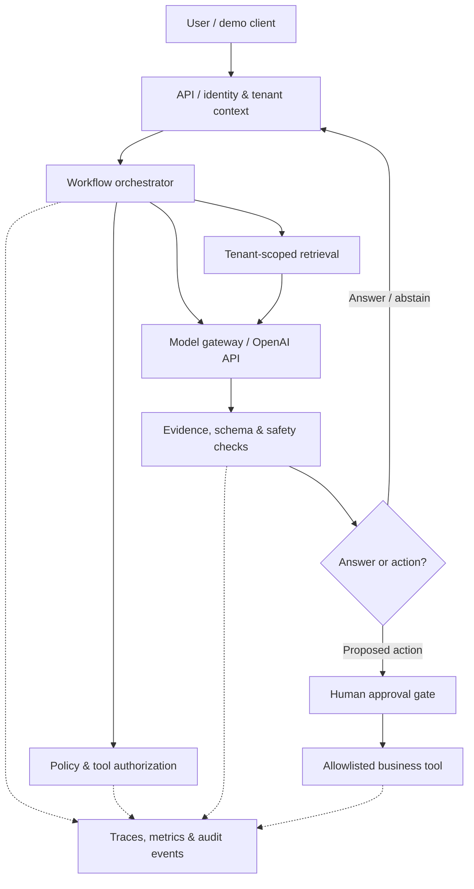

# Trustworthy AI Deployment Lab

**From enterprise AI opportunity to trustworthy deployment and measurable adoption.**

> **Project status — M1 local vertical slice implemented.** The evidence-first methodology, a local synthetic-client Studio, a SQLite-backed API, deterministic report generation, and automated workflow checks are available. **OpenAI runtime integration, real evaluations, authenticated users, enterprise tenant security, cloud deployment, and measured customer adoption are NOT implemented or validated.**

**Maintainer:** [Dani Monteiro](https://www.linkedin.com/in/danimonteirodba/) · [Portfolio](https://danimonteiro.tech/)

**Repository:** [DaniMonteiroDBA/trustworthy-ai-deployment-lab](https://github.com/DaniMonteiroDBA/trustworthy-ai-deployment-lab)  
**Project domain:** `lab.danimonteiro.tech` — subdomain created; website deployment and HTTPS availability are not yet verified.

---

## Why this lab exists

An AI demo can produce a convincing answer while failing to establish whether the answer is supported, whether an action is authorized, or whether the system can be operated safely.

Likewise, an enterprise can invest in AI without first proving that it has selected the right problem, established measurable success criteria, considered non-AI alternatives, or prepared its users and operating teams.

**Expanded mission:** demonstrate a reusable consulting journey that moves from business discovery and readiness assessment through prioritization, architecture, proof of value, controlled deployment, adoption, and measurable outcomes.

The lab has three connected design components:

1. **Trusted AI Adoption Framework** — seven human-accountable decision stages and evidence contracts.
2. **AI Architecture & Evaluation Lab** — one deep, runnable technical reference case (planned).
3. **AI Value & Adoption Studio** — an initial local application for synthetic clients, evidence, decision gates, and executive briefs (**M1 in progress**; advanced architecture/adoption tracking planned).

The methodology is intended to be adaptable across organizations and technology providers. The technical reference case will demonstrate OpenAI integration without implying that all customers must adopt the same platform.

**Start with the specifications:** [Scope](SCOPE.md) · [Methodology](docs/METHODOLOGY.md) · [Decision Contract](docs/DECISION_CONTRACT.md) · [Job Requirements Traceability](REQUIREMENTS_TRACEABILITY.md) · [Backlog](BACKLOG.md).

## Run the local AI Value & Adoption Studio

The current implementation is a **synthetic-only training and architecture reference**. It has **no authentication** and must not be hosted publicly with real information.

Requirements: Python 3.12+; install dependencies in a dedicated virtual environment if appropriate.

```bash
python -m pip install -r requirements.txt
python -m uvicorn app.server:app --host 127.0.0.1 --port 8000
```

Open **http://127.0.0.1:8000** for the Studio or **http://127.0.0.1:8000/docs** for the FastAPI API reference.

The app initializes a local SQLite database in `data/studio.db` (excluded from Git) with three fictional clients. It allows a demo reviewer to add **unverified** synthetic evidence, record a simulated review, make bounded stage decisions, and download a deterministic executive brief. It rejects evidence references from other use cases and prevents approval without verified evidence or while blockers remain. If cited evidence is rejected after approval, the previous `GO` becomes ineffective and downstream stages lock; a later re-verification cannot reactivate it without a new human review. The validation and improvement stages cannot pass without measured evidence from a future evaluation engine.

```bash
python -m unittest discover -s tests -v
python -m scripts.validate_examples examples/fintrust_discovery.json
```

See [M1 Architecture](docs/ARCHITECTURE.md) for explicit trust boundaries and limitations.

This independent, open reference project explores a more demanding question:

**What evidence is sufficient to move an enterprise AI use case from a promising prototype to a controlled deployment?**

The lab is designed around three questions:

1. **What does the system know?** Can it distinguish supported claims from missing, conflicting, or insufficient evidence?
2. **What may the system do?** Are identity, tenant boundaries, tool permissions, and human approvals enforced outside the model?
3. **What can the team verify?** Are quality, safety, latency, cost, regressions, and operational behavior measurable and reproducible?

The goal is not to maximize the number of model calls or agents. It is to make architecture decisions, risk controls, and release decisions **observable and reviewable**.

## Reference use case

The planned deep technical demonstration is an **enterprise knowledge and workflow assistant** serving multiple simulated organizations (tenants). The consultative methodology will additionally cover fictional financial, retail, and public-sector client journeys.

A user may ask a question about internal policies or request a business action. The system must decide whether to:

- Answer with traceable supporting evidence;
- Ask a clarifying question;
- Abstain and explain what evidence is missing;
- Prepare a proposed action for review; or
- Refuse an unauthorized or unsafe request.

**Illustrative scenario (not yet implemented):** A tenant employee asks whether an exception to a purchasing policy is allowed and requests that an approval be submitted. The assistant should find the applicable version of the policy, identify the user's permissions, avoid accessing another tenant's documents, and require explicit authorization before submitting any action.

All examples and datasets will be **synthetic**. No customer, employer, Microsoft, or confidential project material will be used.

## Planned capabilities and evidence

| Capability | Engineering question | Evidence to publish |
| --- | --- | --- |
| Enterprise discovery | Is the use case valuable and appropriately bounded? | Problem statement, stakeholders, assumptions, success criteria, and non-goals |
| Solution architecture | Where are trust boundaries and failure points? | Architecture diagram, ADRs, data flows, and trade-off analysis |
| Applied AI integration | Are model calls, retrieval, and tools composed safely? | Source code, versioned interfaces, contract tests |
| Grounded answers | Can the assistant distinguish evidence from inference? | Citation checks, answerability tests, abstention analysis |
| Authorized actions | Can it prevent unauthorized or accidental execution? | Tenant-isolation tests, permission tests, approval-state tests |
| Security and privacy | Can malicious content trigger unsafe behavior or data exposure? | Threat model, adversarial test cases, redaction tests |
| Evaluation and release | Is a change demonstrably better and acceptably safe? | Versioned evaluation dataset, baselines, regression report, release gates |
| Operations | Can engineers identify failures, cost, and latency? | Structured telemetry, trace examples, runbooks, failure-injection results |

These are **planned deliverables**, not assertions about the current repository.

## Proposed architecture



**Trust boundaries:**

- Identity, tenant scope, and permissions originate in application services, **never** in instructions generated by the model.
- Retrieved text is untrusted context, not a source of executable instructions.
- Model output is a proposal until validated against schemas, policies, and any required human approval.
- Tools execute with narrow, explicit permissions and auditable inputs.
- Logs and traces must not expose secrets or unnecessary personal data.

The diagram is a **design proposal**. Architecture decision records will document changes made during implementation.

## Explicit non-goals

- Claiming enterprise production readiness from a demonstration alone.
- Training or fine-tuning a foundation model.
- Connecting to real company systems or ingesting confidential datasets.
- Letting the model directly authorize its own tool use.
- Treating model confidence scores as independently verified evidence.
- Using a single aggregate benchmark to hide critical security or correctness failures.

## Evaluation design

The intended evaluation harness will use **versioned synthetic cases** and compare candidate configurations against clearly defined baselines. Each result should be attributable to a code version, model/configuration, dataset version, and test run.

| Dimension | Example evaluation questions |
| --- | --- |
| Task success | Did the assistant solve the user's supported request? |
| Evidence quality | Are material claims supported by the retrieved source and the correct policy version? |
| Abstention | Did it stop when the answer was not established by the available evidence? |
| Tenant isolation | Could any cross-tenant content or action be accessed? |
| Tool authorization | Was a disallowed action blocked even when requested in natural language? |
| Prompt-injection resistance | Did instructions embedded in retrieved content change tool permissions or system policy? |
| Operational efficiency | What were observed latency, token usage, error rates, and estimated API costs? |

**Planned test categories:** normal cases, ambiguous requests, insufficient evidence, conflicting evidence, stale policies, malformed inputs, partial service failures, malicious retrieved content, denied permissions, and attempted tenant-boundary violations.

An evaluation run should produce:

1. Machine-readable results by test case;
2. A human-readable summary of successes, failures, and uncertainty;
3. Reproducible configuration and dataset references;
4. Critical failure examples with investigation notes; and
5. A recorded **go / no-go** release decision.

**No numerical thresholds have been validated or selected yet.** Release thresholds will be proposed and documented before results are used to make a deployment claim. Critical failures such as unauthorized tool execution or cross-tenant disclosure are intended to be independent release blockers, regardless of average task-success score.

## Security and responsible deployment

Controls planned for implementation and testing:

- Tenant-scoped data access and defense against cross-tenant disclosure;
- Authentication and external authorization checks for sensitive actions;
- Tool allowlists, constrained arguments, and explicit human approval gates;
- Prompt-injection, data-exfiltration, and unsafe-output test cases;
- Input validation, structured output checks, bounded retries, and timeouts;
- Secret management outside source control;
- Privacy-conscious telemetry, audit trails, and retention decisions;
- Cost and usage limits, fallback behavior, and a documented rollback path.

The repository will distinguish **design intent**, **implemented control**, and **control verified by automated or manual testing**. A security checklist is not evidence that a control is effective.

## Planned repository structure

The directories below describe the proposed layout; they may not exist yet.

```text
trustworthy-ai-deployment-lab/
├── SCOPE.md              # Vision, stages and acceptance criteria
├── BACKLOG.md            # Phases and work sequencing
├── REQUIREMENTS_TRACEABILITY.md
├── app/                 # Local Studio API and store; future model/retrieval adapters
├── studio/              # Executable synthetic-client frontend
├── examples/             # Synthetic consulting decision records
├── scripts/              # Contract and evidence validation
├── datasets/            # Synthetic and versioned evaluation cases
├── evals/               # Evaluators, baselines, reports
├── tests/               # Unit, integration, security, and adversarial tests
├── docs/
│   ├── METHODOLOGY.md     # Seven-stage adoption process
│   ├── DECISION_CONTRACT.md
│   ├── discovery/       # User needs, success criteria, assumptions
│   ├── architecture/    # Diagrams, interfaces, ADRs
│   ├── security/        # Threat model and trust boundaries
│   └── operations/      # SLOs, runbooks, release and rollback
├── infra/               # Reproducible deployment definitions
└── .github/workflows/   # CI checks and evaluation gates
```

Environment setup, supported versions, local run commands, test commands, and deployment steps will be documented **after those commands exist and have been verified**. Until then, this README is not a runnable installation guide.

## Delivery roadmap

| Phase | Scope | Exit evidence | Status |
| --- | --- | --- | --- |
| 0 — Define | Seven-stage methodology, decision contract, synthetic example, scope and traceability | Documentation, validation checks and human review | In progress |
| 1 — Build | Synthetic client Studio, decision gates and later model/retrieval integration | Local portfolio and decision slice exists; runtime integration pending | In progress |
| 2 — Verify | Evals, adversarial cases, observability, cost/latency measurement | Reproducible evaluation results | Planned |
| 3 — Release | CI gates, documented deployment, rollback, demo | Release decision and deployment evidence | Planned |

**Implementation planning start:** November 17, 2026. Milestone completion dates will be recorded only after work is done.

### Validate the current synthetic contract example

The following commands check the current **limited method contract**, not the behavior of an AI application:

```bash
python -m unittest discover -s tests -v
python -m scripts.validate_examples examples/fintrust_discovery.json
```

## Definition of done

A public demonstration alone will not close the project. A meaningful reference release should have:

- [ ] A runnable documented application using only synthetic data;
- [ ] Versioned API and architecture decisions;
- [ ] Explicit authorization boundaries for every action;
- [ ] Automated tests for normal, failure, and adversarial cases;
- [ ] Reproducible evaluation datasets and reports;
- [ ] Measurements for task quality, latency, and cost;
- [ ] Traceability from user request to evidence and action outcome;
- [ ] CI checks with explicit, justified release-blocking criteria;
- [ ] Deployment and rollback instructions verified end to end;
- [ ] A concise demonstration and a candid limitations section.

Unchecked items are intentionally **not claimed as completed**.

## Evidence and limitations

This project will report what was tested, under which conditions, and what failed. Synthetic evaluations can demonstrate engineering properties of a controlled implementation; they do not automatically establish suitability for any specific regulated or production environment.

Reports will separate measured observations from assumptions. Architecture choices and limitations will be updated as implementation proceeds.

## About

Created by **Dani Monteiro**, Data & AI Solutions Architect, technical educator, and PhD researcher at the University of São Paulo. Her research explores the reliability of AI systems and the relationship between evidence, uncertainty, and authority under incomplete documentation.

- [LinkedIn](https://www.linkedin.com/in/danimonteirodba/)
- [Portfolio](https://danimonteiro.tech/)

**Independence notice:** This is a personal open reference project. It is not an official OpenAI project, and it does not disclose or represent implementations performed for previous employers or customers.

**License:** To be selected before publishing reusable source code.
