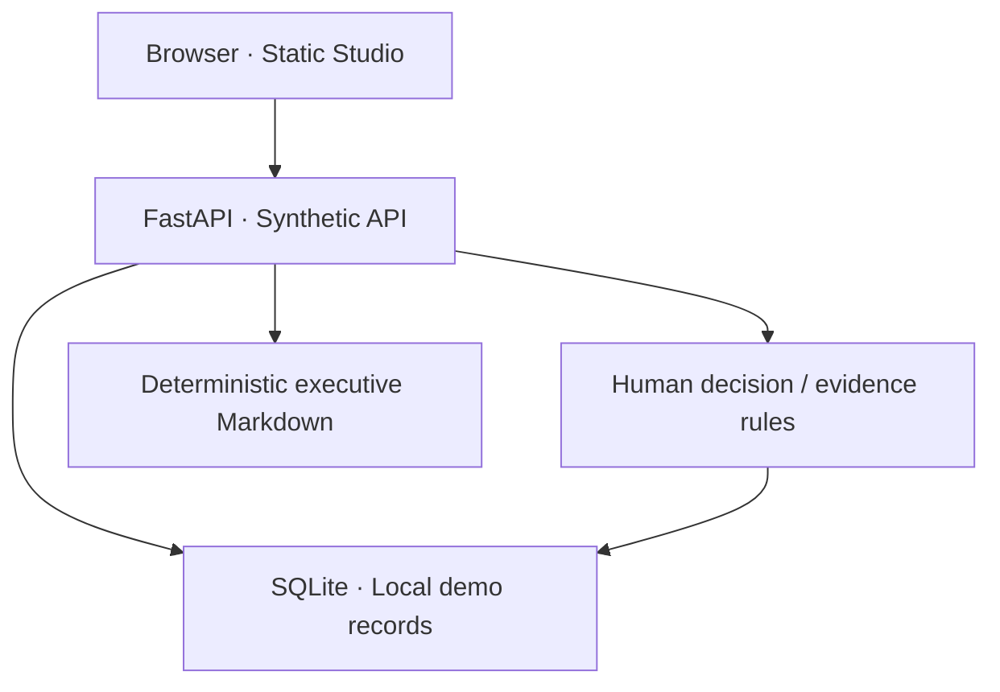

# AI Value & Adoption Studio — M1 Architecture

**Status:** local synthetic M1 Studio, offline M2 evaluation, M3 review worksheet/comparison and adoption policy, and M4 local fictional assessment workshop implemented; optional OpenAI adapter is mock-tested only. Cloud deployment, authentication, genuinely independent human calibration, enterprise authorization, live model evaluation and production security controls are **not verified**.

## Architecture boundary

The frontend is static HTML/CSS/JavaScript. It uses same-origin calls to a FastAPI service. Each API request opens its own SQLite connection with parameterized queries and foreign-key constraints. The first initialization seeds three fictional organizations.

## Implemented API (local, non-production)

| Method | Endpoint | Behavior |
| --- | --- | --- |
| GET | `/api/health` | Explicitly identifies synthetic local mode |
| GET | `/api/clients` | Lists three fictional accounts |
| GET | `/api/clients/{client_id}` | Account and use-case portfolio |
| GET | `/api/cases/{case_id}` | Evidence, decision history and effective stage states |
| POST | `/api/cases/{case_id}/evidence` | Records unverified synthetic evidence; refuses manual `MEASURED` claims |
| POST | `/api/evidence/{evidence_id}/review` | Appends a simulated review with self-entered reviewer name |
| POST | `/api/cases/{case_id}/decisions` | Records gate outcome after consistency checks |
| GET | `/api/cases/{case_id}/executive-report` | Generates deterministic synthetic brief without fabricating metrics |
| POST | `/api/evaluations/offline` | Runs local, versioned baseline versus deterministic rules; never calls OpenAI |
| GET | `/api/evaluations/latest` | Reads locally persisted synthetic evaluation artifact |
| GET | `/api/adoption/scenarios` | Reads four frozen, versioned fictional advisory scenarios; never changes gates |
| GET | `/api/adoption/scenarios/{scenario_id}` | Retrieves one read-only, risk-aware adoption recommendation |
| POST | `/api/adoption/assessments` | Appends a validated fictional assessment and advisory recommendation to local SQLite |
| GET | `/api/adoption/assessments` | Lists recent fictional snapshot summaries |
| GET | `/api/adoption/assessments/{assessment_id}` | Retrieves persisted input and recommendation with SHA-256 |
| GET | `/api/adoption/assessments/{assessment_id}/report` | Renders an evidence-linked synthetic Markdown adoption brief |

The M4 assessment table is **append-only through the exposed API** and is independent from the `decisions`, `decision_invalidations`, and `evidence_reviews` tables. The source SHA-256 fingerprints the canonical fictional input but is not a secure audit signature. The UI is not a sensitive-data intake. See [Synthetic Assessment Workshop](SYNTHETIC_ASSESSMENT_WORKSHOP.md).

## Stage state and history

The stage order is `DISCOVER`, `ASSESS`, `PRIORITIZE`, `ARCHITECT`, `VALIDATE`, `ADOPT`, `MEASURE_IMPROVE`.

- A stage is unlocked only when all preceding gates have an effective `GO`.
- Review decisions are appended; prior records remain visible in `decisions` history.
- Rejecting cited evidence appends a durable `decision_invalidations` record for each affected `GO`. Even if evidence is later verified again, the recorded approval cannot silently reactivate: a new human review must be entered. Effective status becomes `REWORK` while the original `GO` remains in audit history.
- If an earlier stage loses `GO`, downstream stage approvals are **effectively locked** until the dependency is restored.
- A `GO` cannot cite evidence from another use case, bypass unresolved blockers, or rely solely on unverified/inferred material.
- `VALIDATE` and `MEASURE_IMPROVE` cannot receive `GO` until actual measured evidence is ingested by a future trusted integration.

The current code implements **application-level workflow checks**, not legal authority, technical accreditation, or identity-based authorization.

## Important risk boundaries

1. **No real authentication or identity verification.** Reviewer names are self-entered. Do not treat `GO` as a real organizational signoff.
2. **No enterprise tenant authorization.** The API exposes three public fictional accounts. Query filters by case ID prevent accidental cross-case evidence references, but do not protect real tenants.
3. **No real client or confidential data.** The demo server may accept arbitrary user-supplied text. Run locally with fictional content only and never publish it as a production service.
4. **No measured AI outcomes.** M2 tests cover deterministic fixture behavior and a mocked API adapter; no live model or real customer outcome has been measured.
5. **No cloud release or data-retention process.** SQLite persists locally at `data/studio.db` and is excluded from Git.
6. **Advisory engine is separate from authority.** Its hypothetical `GO` never updates the SQLite human decision log or authenticates a reviewer. Source labels `SIMULATED_VERIFIED` are intentionally fictional. The M4 attestation checkbox does not prevent users from pasting actual sensitive material.

## Planned architecture progression

- **M1 next:** review business schema and programmatic case templates; evaluate usability with a real human reviewer using only fictional data.
- **M2 implemented portion:** versioned offline runner, separate search baseline and rules candidate, active-document/tenant-scoped retrieval, local UI summary and optional mock-tested OpenAI Responses adapter. See [Evaluation Factory](EVALUATION_FACTORY.md).
- **M2 still pending:** authenticated users, enterprise tenant authorization and action approval machine.
- **M3 implemented portion:** provenance-bound synthetic reviewer worksheets with immutable source fields, two-sheet comparison, explicit reviewer disagreements, critical-failure lists, and bounded live-run case volume (without a USD cap). See [Human Review Protocol](HUMAN_REVIEW_PROTOCOL.md).
- **M3 adoption policy slice:** explicit evidence links, eight mandatory decision dimensions plus high-risk independent review, blocker precedence and four illustrative recommendations. All advisory only. See [Adoption Decision Engine](ADOPTION_DECISION_ENGINE.md).
- **M4 implemented slice:** editable fictional assessment form, strict input boundary, local append-only snapshots, SHA-256 and advisory Markdown brief; not a real customer workspace. See [Synthetic Assessment Workshop](SYNTHETIC_ASSESSMENT_WORKSHOP.md).
- **M3 pending:** actually independent human-calibrated evals, adjudication, live model testing and cost tracking, reviewed measured-evidence ingestion, threat model, safe telemetry and repeatable release gates.
- **M4:** real deployment architecture, privacy and retention decisions, synthetic account analytics, operational readiness and handoff.

See [SCOPE](../SCOPE.md), [Decision Contract](DECISION_CONTRACT.md), and [traceability](../REQUIREMENTS_TRACEABILITY.md).
